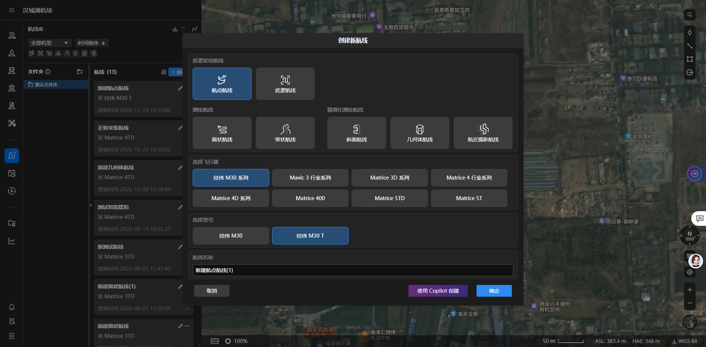

# 资源与数据来源参考

- 大疆司空2网站：https://fh.dji.com/organization/fb1d4a20-4b63-4f57-9f7f-af4b574d1013/project/2c0d38fa-294b-4073-8074-e0aa12184fce#/wayline
- kmz 航线格式: https://github.com/dji-sdk/Cloud-API-Doc/tree/master/docs/cn/60.api-reference/00.dji-wpml
- 大疆机场2参数：https://enterprise.dji.com/cn/dock-2/specs
- 大疆机场3参数：https://enterprise.dji.com/cn/dock-3/specs
- 大疆机场4参数：https://enterprise.dji.com/cn/dock-4/specs

# 设备说明
- 大疆机场2对应无人机为M3TD/M3D
- 大疆机场3对应无人机为M4TD/M4D
- 大疆机场4对应无人机为M5TD

# 页面说明

- 参考大疆司空2，绘制航线前需要选择设备及航线类型

  

